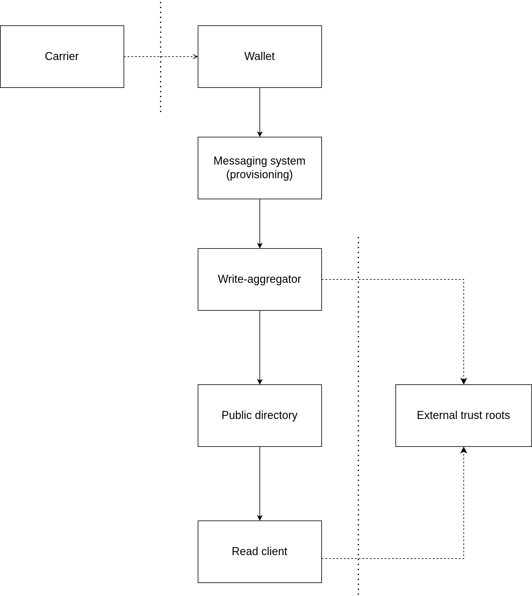

# A Privacy-Preserving Phone Book for Federated Messaging

*A use-case document for wallet-anchored pseudonyms.*

Nathan Schepers — 2026-05-21

## 1. Introduction

Centralised messaging platforms made phone number-based discovery a default. People know their own phone numbers, share them readily, and use them as the social identifier they reach for first when they want to find someone. The convenience of this is hard to overstate; the cost is the platform operator's ownership of the social graph.

Federated messaging systems have no comparable mechanism. The trade-off is sometimes framed as a virtue — no central directory, no operator surveillance — but in practice it shifts the discovery problem to the user: the phone number — the most commonly used discoverability key — is unavailable, replaced by per-service identifiers that users must exchange before any conversation can begin. Federated messaging systems lose the network effect that phone number-based discovery delivers, not because the underlying protocols cannot accommodate discovery, but because no privacy-preserving construction with these properties has yet been articulated.

The EUDI wallet enables one such construction: an opt-in phone book of per-service pseudonymous account identifiers, each derived from the user's wallet and keyed by their phone number. The pseudonyms are unlinkable across services. Entries are verifiable offline against published trust roots, so any party can serve a mirror and any party can verify what's served. No party, including the phone book operator, has privileged authority over the contents; the operator likewise learns nothing about which numbers any reader is looking up. In addition, by providing the very same discoverability key as existing platforms, the construction could enable cross-platform interoperability per the DMA.

## 2. Assumptions

The construction depends on the underlying wallet and credential ecosystem providing the following properties.

### Assumption 1 — No stable cross-presentation identifier

The credential must not carry a stable per-credential identifier in any channel observable across presentations, including the presentation envelope, claim disclosures, and revocation interactions.

### Assumption 2 — Per-(service, credential) pseudonym determinism

Relying parties must be able to request pseudonyms from the wallet. These pseudonyms must be deterministic over a service identifier and an underlying credential. Same user, same credential, same service identifier yields the same pseudonym. Different service with the same credential yields a different and unlinkable pseudonym.

### Assumption 3 — Pseudonym proof in zero knowledge

The wallet must produce a proof that the pseudonym was correctly derived from the named credential against the named service identifier. The proof reveals the pseudonym and nothing else: not the credential, not the derivation key, not the issuer beyond "trusted-list member, not revoked."

The proof carries two further properties:

- **Current non-revocation at the moment of presentation.** The proof must demonstrate that the credential is non-revoked at the moment the proof is constructed. Records written to the public directory inherit this liveness at the moment of writing.
- **Derivation includes material the issuer never observes.** This prevents the issuer from computing pseudonyms for any service from the credential's claim material alone.

### Assumption 4 — Proof of association

The pseudonym, the credential it is derived from, and the disclosed discoverability key must be bound as one wallet's act of presentation.

## 3. Construction: Information-Flow Walkthrough

*Figure 1* shows the flow. The example is **MSISDN-anchored**: the carrier-attested phone number credential serves as both the discoverability key and the credential the pseudonym is derived from.

### Step 1 — Credential issuance

The user's wallet, already enrolled, receives a credential from the user's carrier. The credential carries the phone number as a selectively-disclosable claim.

*Assumptions: 1.*

### Step 2 — User initiates onboarding

The user opens a messaging client (a Matrix client in this example) on a device where they can engage their wallet, intending to create an account discoverable at their phone number.

Onboarding requires a presentation from the wallet that discloses the phone number claim from the carrier credential and produces a pseudonym derived from that credential against a service identifier. Here the service identifier is the Matrix homeserver's DNS name.

The user is shown a consent screen and approves.

*Assumptions: 2.*

### Step 3 — Wallet constructs the presentation

The wallet constructs a presentation containing three elements:

1. The phone number claim, selectively disclosed from the carrier credential.
2. A pseudonym, deterministically derived from the carrier credential and the service identifier from step 2.
3. A zero-knowledge proof that the phone number claim was correctly disclosed from a non-revoked credential signed by a trusted carrier, and that the pseudonym was correctly derived from the same credential against the named service identifier.

The proof reveals the phone number and pseudonym, that the issuer is trusted, and that the credential is non-revoked. Nothing else.

*Assumptions: 1, 2, 3.*

### Step 4 — Account creation

The messaging stack creates the user's account on the homeserver. For the construction, it is enough that the MXID local part is derived directly from the pseudonym; any reader of the directory can compute the MXID from the pseudonym without consulting any server.

The directory entry asserts the (phone, pseudonym) binding, not that an account exists at the derived MXID or that it was provisioned from this presentation; a reader learns whether the account is live only at message-send time. A provisioning agent can close this loop (see §5.7).

*Assumptions: none.*

### Step 5 — Delivery to the write-aggregator

The messaging stack delivers the presentation to the phone book's write-aggregator as part of provisioning.

*Assumptions: none.*

### Step 6 — Write-aggregator verifies and admits

The write-aggregator performs the authoritative cryptographic verification of the bundle and decides whether to admit it to the public directory. Every assumption the wallet exercised is checked here. The check is mechanical and offline against external trust roots; the write-aggregator pulls the trusted list and the revocation data the same way any reader at step 8 would.

The checks performed:

- The bundle envelope is well-formed.
- The carrier signature verifies against the trusted list; the issuer is recognised.
- The revocation status of the credential is consulted via bulk download (no per-query interaction with the revocation host).
- The credential's validity period has not expired.
- The pseudonym zero-knowledge proof validates against the supplied service identifier, against the carrier signature, and against the revocation check.

The checks deliberately *not* performed:

- Account existence on the homeserver. This is a federation question, online, and not part of the write path. Contact with the homeserver happens at message-send time anyway.
- The submitter's identity. The verification depends only on the bundle and the external trust roots, not on who delivered it, and produces the same outcome regardless.
- Anything about the human behind the wallet.

The write-aggregator does not add a cryptographic signature of its own to the admitted record. The record is the validated presentation; its trust comes from the underlying credential signatures and the pseudonym proof, not from the write-aggregator's authority. This is why a read client at step 8 can verify the same record against the same trust roots and reach the same conclusion without trusting the write-aggregator at all.

*Assumptions: 1, 2, 3.*

### Step 7 — Record in the public directory

The admitted record sits in the append-only public directory as part of the bulk-download dataset. The directory is public: no access controls, no privileged readers, no per-query interaction.

The record is the validated presentation from step 3. It carries the phone number, the pseudonym, the pseudonym proof, and whatever the credential format carries that is not sealed inside the proof — which is where assumption 1 applies.

The record validates against external trust roots until the underlying credential expires or is revoked, at which point it fails verification at step 8.

Right-to-be-forgotten at the directory layer is not a property the construction offers; tombstones provide withdrawal from latest-wins resolution but not erasure (§5.1).

*Assumptions: 1.*

### Step 8 — Read client fetches and verifies offline

A read client fetches three things from any mirror of the directory:

1. The current phone book bulk dataset.
2. The current revocation data for the relevant issuers.
3. The current trusted list.

All three are pure downloads. No per-query interaction with any operator. The mirrors are untrusted — they serve bytes; they do not vouch for content.

Given a phone number, the client locates matching entries in the dataset and, for each entry from newest to oldest, verifies: the carrier signature against the trusted list; the revocation status against the revocation data; the credential's validity period; the pseudonym zero-knowledge proof; and whether the entry is the latest non-tombstoned entry for the (phone, service) pair. If everything checks, the client derives the MXID.

All verification is offline against external trust roots. The operator sees only download metadata — IP address, timing, size — not which numbers are checked, how many match, or who the client messages next.

The read client need not be a Matrix client. Any party with the bulk dataset and the trust roots can verify the same records and reach the same conclusions.

*Assumptions: 1, 2, 3.*

## 4. Closing Claim

The construction provides, in composite across the walkthrough, the following properties:

- **The phone book operator learns nothing about queries.** There are no queries — only bulk downloads. The operator's information about any reader is restricted to network metadata of the download, not the content of any lookup.
- **Pseudonyms are unlinkable across services.** Assumption 2, satisfied at step 3, ensures that the pseudonym a user produces at service X is unlinkable to the pseudonym the same user produces at service Y, because the derivation scopes on the service identifier.
- **Cross-service discoverability by phone number is preserved.** The phone number is the discoverability key; any reader can resolve a phone number at any service that publishes to the directory and at which the user has opted in.
- **Account continuity across phone number changes**, in configurations where the underlying credential outlives the discoverability-key credential (see §5.4). A user who changes phone numbers can submit a fresh entry binding the new number to the same pseudonym; existing contacts find them at the new number through the same MXID. The public log will show the linkage between the two phone numbers as a feature of the discoverability the user opted in to; it does not leak anything the user did not volunteer. The MSISDN-anchored configuration does not have this property, since the underlying credential is the carrier credential itself.
- **Port handling falls out of revocation verification.** A ported number whose old carrier credential is revoked stops resolving at the next read-side refresh, without any directory-level coordination required.
- **Mirrors are safe.** Because every record is self-verifying against external trust roots, a mirror cannot lie about content. The same property makes the construction audit-friendly: any researcher can pull the corpus and reason about its properties end-to-end.
- **No party — including the directory operator — has privileged authority over the contents.** The write-aggregator is a gatekeeper, not a notary; its acceptance of an entry is verifiable by anyone with the bulk dataset and the trust roots. The construction admits federation of write-aggregators (governance discussion deferred to §5.5) without changing any of the foregoing.
- **No party has built-in re-identification capability** beyond what the underlying credentials and trust roots already provide.

## 5. Discussion

### 5.1 Right-to-be-forgotten as a non-property

The construction does not deliver right-to-be-forgotten at the directory layer. The directory is public and bulk-downloadable, so law enforcement, data brokers, and archivists can keep their own snapshots, and a protocol-level deletion does not reach those copies.

The privacy lever available to the user is opt-in, at per-service granularity: a user who submits no entry has no directory exposure beyond what they have otherwise published. Tombstones — wallet-signed withdrawal records in the same append log — remove an entry from latest-wins resolution but do not erase it from the log or from any snapshot of it.

### 5.2 Cost of public discovery

Keying discovery on a disclosed credential attribute makes that attribute public. The discoverability key — the phone number, in the configurations here — appears in cleartext in every entry that publishes it, and anyone who holds the attribute can find the entry: the issuer who attested it, a contact who has the number, an observer who already has it. This is what discoverability by that key means, and it is no different in kind from publishing the same number or email address on a personal website.

Cryptographic unlinkability covers the derived pseudonyms, not the disclosed key. The per-service pseudonyms are unlinkable to each other, but the discoverability key published alongside them is the same value wherever it appears, linking those entries to one another and to the person who holds it. Nothing in the construction removes this. The user's lever is the one in §5.1: opt in per service, or not at all.

### 5.3 Stable correlators and public disclosure

Assumption 1 forbids a stable identifier carried across presentations. Under per-query access this matters per relying party: a credential that leaked such an identifier would let each relying party correlate a holder's presentations to it, but correlating across relying parties would still require those parties to share what they saw.

Public disclosure removes that limit. Every admitted entry sits in one public dataset, so a stable identifier present in presentations would appear in every entry that carries it, and the directory itself becomes the join point: any party could link all of a holder's entries across every service from the shared identifier alone, with no one colluding.

Assumption 1 is what holds this off. With no stable identifier beyond the deliberately-disclosed discoverability key, a holder's entries are joinable only by the key they chose to publish (§5.2); entries published under different keys stay unlinked, where a stable correlator would have joined them.

### 5.4 Choosing the underlying credential

The underlying credential — the one the pseudonym derives from — is a deployment choice. It fixes what the pseudonym means and what cardinality the construction admits per service, while the read side is unchanged whatever the choice. In the MSISDN-anchored example the underlying credential is the carrier credential that also supplies the discoverability key, so the two coincide. Where they differ, the wallet presents both and proves their association, and the entry fails verification if either credential is revoked.

In a decentralised messaging or social-media deployment, the choices might include the following — each able to be displayed as a verified badge:

- **PID association** — one account per person, verified by the state; the basis for bot-resistance where person-backedness matters.
- **Corporate badge or employment credential** — one account per employee.
- **Professional or membership credential** — verified membership in the named body.
- **Residency, via PID selective-disclosure or association** — verified presence in a jurisdiction.

Two things are worth keeping apart. Binding the underlying credential to the discoverability key is required: it is what stops a pseudonym being spliced onto a key the holder did not present. Disclosing anything *about* the underlying credential is a separate, deployment-dependent choice — a configuration can prove the association in zero knowledge, revealing only that a credential of the required family backs the pseudonym, or it can disclose attributes of it where the deployment wants them visible (residency, employer, membership).

*Assumptions: 4.*

### 5.5 Operator governance of the write-aggregator

The write-aggregator is the one component whose identity matters operationally rather than cryptographically. Losing it is a liveness failure — no new entries are admitted — not a safety failure: existing entries still validate against the trust roots, and mirrors still serve them.

Governance can be a single operator, or a federation of operators with transparency-log-shaped consensus, in the precedent of Certificate Transparency. The choice is operational, not architectural, and the construction is indifferent to it.

### 5.6 Pseudonym unlinkability vs unmaskability

These are different properties. Unlinkability means two pseudonyms cannot be tied to the same holder, which the construction provides across services. Unmaskability means no one can work backwards from a pseudonym to the person.

There must be no path by which an issuer reverses a pseudonym to the holder of the credential it derives from. The consent is specific: the user is warned that the discoverability key is public (§5.2) and agrees to that, and to nothing more. Being identifiable from the pseudonym is not part of that bargain.

### 5.7 The provisioning agent

A provisioning agent in the messaging service stack — the component that mints the account — can attest more than the directory entry carries. It can issue an account identifier other than one derived from the pseudonym, attesting the (pseudonym, identifier) link, and it can attest that the account was provisioned from the published presentation, closing the loop from §3 step 4. Both add a trust assumption on the provisioning agent, and neither overrides a homeserver's control of its own namespace.

It is also where deployment-side state would live — profile metadata that can drive enforced gating, age verification, or the badges of §5.4 — none of which the directory holds.

### 5.8 Social-graph leakage

Every per-contact query against a directory has the unfortunate side effect of telling the operator who is checking whom. Centralized messaging platforms such as WhatsApp go further, bulk-querying each user's contact list at signup and handing the operator the graph up front.

This construction resolves discovery offline. The client downloads the directory, trust roots, and revocation data in bulk and checks contacts against its local copy; the operator sees the download but not which numbers were checked. A client can resolve a whole contact list this way at onboarding and refresh periodically, or check numbers individually — in either case nothing about the contacts it holds leaves the device.

### 5.9 DMA

The discoverability key is the phone number — the same key WhatsApp and existing platforms use for discovery, carried here as a carrier-signed credential rather than proven by SMS one-time-password, and so not subject to the SIM-swap, SS7, and spoofing weaknesses of SMS. Where the pseudonym derives from a PID, or is associated with one, the entry can also carry proof of EEA residency.

Together this addresses two of the questions DMA interoperability raises: a shared discovery key by which a user on one platform can be found from another, and the EEA residency a gatekeeper must establish.

## 6. Conclusion

On centralized platforms, the cost of phone number-based discovery is the operator's ownership of the social graph. The described phone book keeps the convenience without the cost: a person stays discoverable by the number their contacts already have, by exposing only their phone number and a pseudonym.

The system is enabled fundamentally by the EUDI wallet. The §2 assumptions — pseudonyms a relying party can request, deterministic and unlinkable across services, proven without revealing the credential behind them — are what make a public directory safe to read, mirror, and verify without trusting whoever runs it.

Because the key is the phone number people already share, the phone book also fits the DMA setting: cross-platform discovery and a residency proof, on the same key existing platforms use and attested to a higher standard.
